<h2 data-importer="text" align="left">YOLO!</h2>

  
  
  
  

###

 

<picture data-importer="pacman">
  <source media="(prefers-color-scheme: dark)" srcset="https://raw.githubusercontent.com/AbduOnPengu/AbduOnPengu/pacman-output/galaga-contribution-graph-dark.svg?game=galaga">
  <source media="(prefers-color-scheme: light)" srcset="https://raw.githubusercontent.com/AbduOnPengu/AbduOnPengu/pacman-output/galaga-contribution-graph.svg?game=galaga">
  
</picture>

###
